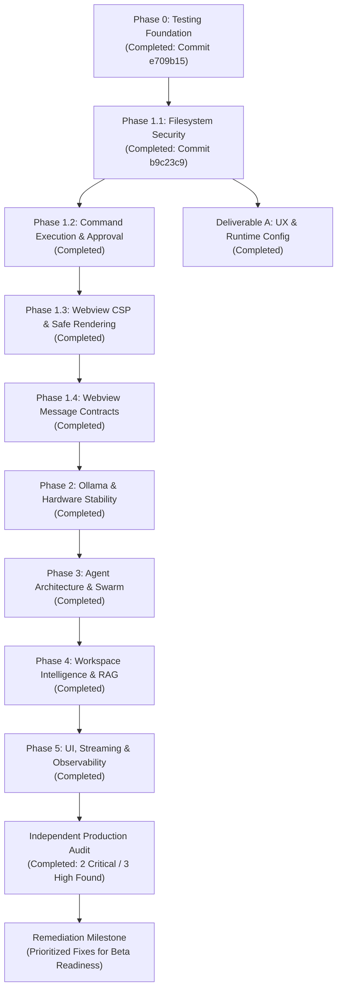

# Local Copilot Chat — Hardening & Engineering Roadmap

A structured, multi-phase roadmap to transform `local-copilot-chat` into a production-grade, local-first AI coding assistant under an 8 GB VRAM budget constraint, while serving as a rigorous hands-on exercise in agent engineering and forward-deployed systems design.

---

## Controlled Workflow & Decision Hierarchy

We operate under a disciplined, verification-first lifecycle:

```
[1. Architecture Audit] ──► [2. Technical Design] ──► [3. User Approval]
                                                            │
                                                            ▼
[6. Commit Approval] ◄── [5. Independent Review] ◄── [4. Scoped Implementation]
         │
         ▼
[7. Next Phase / Milestone]
```

* **User**: Final decision-maker. Sets scope, grants permissions, approves designs, reviews diffs, and authorizes commits.
* **Architect Agent**: Inspects code, analyzes security boundaries, identifies regressions, designs solutions. Read-only.
* **Developer Agent**: Implements only the approved technical scope. Never modifies code outside the approved phase.
* **Tester Agent**: Builds and executes deterministic unit, integration, and physical security tests.
* **Reviewer**: Evaluates code, challenges assumptions, verifies invariants, and audits Git diffs.

---

## 1. Overall Project Roadmap & Status



### Live Status Matrix

| Phase / Item | Milestone | Status | Key Deliverable | Verified Metrics |
|:---:|---|:---:|---|---|
| **Phase 0** | Testing Foundation | **COMPLETED** | Isolated test infrastructure, baseline tests, `.vscodeignore`, clean Git init. | 18 passing, Commit `e709b15` |
| **Phase 1.1** | Filesystem Security | **COMPLETED** | Centralized boundary validation, multi-root determinism, symlink/junction defense, internal state lock. | 31 passing, Commit `b9c23c9` |
| **Phase 1.2** | Command & Approval Security | **COMPLETED** | Safe command whitelist, tokenization, 4-tier classification, `ExecutableResolver`, `GitExecutionIsolator`, unbypassable approval. | 45 passing tests |
| **Phase 1.3** | Webview CSP & Sanitization | **COMPLETED** | Strict CSP (`default-src 'none'`), script origin isolation, XSS prevention. | 1 passing test |
| **Phase 1.4** | Webview Message Contracts | **COMPLETED** | Validated schemas for IPC between Webview and extension host via `MessageValidator`. | 10 passing tests |
| **Del A.1** | Ollama Connection Reliability | **COMPLETED** | Fixed `modelsError` handler, connection health badge (Online/Connecting/Offline/No Models), actionable offline banner with retry, stale request guard, drafted text protection. | 10 passing tests |
| **Del A.2** | Code Block UX & Language Mapping | **COMPLETED** | Prominent Copy button with temporary `✓ Copied!` checkmark feedback and extension host clipboard fallback, robust language-to-extension dictionary mapping, streaming incomplete fence resilience, XSS-hardened language identifier handling. | 18 passing tests |
| **Del A.3** | Configuration Settings (`package.json`) | **COMPLETED** | Centralized `ConfigurationService`, `numCtx`, `temperature`, `maxTurns` exposed in `package.json`, tool-calling determinism ceiling (0.1), dynamic context compaction scaling, endpoint change sync. | 24 passing tests |
| **Phase 2 & 3** | Runtime, Router & Swarm Hardening | **COMPLETED** | Stringified JSON tool-call extraction, sub-agent repetition loop defense, evidence verification requirement prior to completing tasks. | 12 passing tests |
| **Phase 4** | Memory, Indexing & Persistent RAG | **COMPLETED** | Secret & binary file exclusion filter, stale chunk pruning, atomic file writes (`.tmp`), corrupted file backup (`.corrupt`). | 12 passing tests |
| **Phase 5** | Streaming UX & History Restoration | **COMPLETED** | Separation of `<think>...</think>` tokens into collapsible `<details>` disclosure, persistent chat history save/restore. | 13 passing tests |
| **Audit** | Production Readiness Audit | **COMPLETED** | Exhaustive read-only review: identified 2 Critical and 3 High issues blocking release. | Audit Report Published |
| **Phase 5.1** | Production Readiness Remediation | **COMPLETED** | Repaired `/diff`, Windows `node.exe` npm resolution, Webview CSP nonce & event delegation, Swarm task isolation, atomic rename, and thought sanitization. | 163 passing tests |
| **Phase 5.5 (H1)** | Critical Hardening & Process Safety | **COMPLETED** | Decoupled `AppGeneratorService` shell chaining; eliminated ComSpec/cmd.exe; trusted canonical Node.js resolution; stream turn ownership & centralized exactly-once `streamEnd`; reserved slash command guidance. | 174 passing tests |
| **Phase 5.5 (H2)** | High-Severity Hardening | **COMPLETED** | Webview CSP nonce enforcement & zero inline handlers; escaped template sinks and sanitized attribute contexts (`appendTimelineStep`); Swarm Whiteboard Schema v2 with per-task identity (`taskId`), task isolation, and legacy v1 migration; single-flight generation concurrency guard with generation-owned cleanup. | 184 passing tests |
| **Phase 5.5 (H3)** | Medium-Severity Hardening | **COMPLETED** | Shared `AtomicFileWriter` with PID naming & mutex serialization; `<think>` token suppression; host-side modal confirmation for Tier 2/3 `runCommand` with Workspace Trust; Git config & hook isolation (`core.hooksPath=/dev/null`, `diff.external=`, `merge.tool=`, `GIT_CONFIG_NOSYSTEM=1`). | 197 passing tests |
| **Phase 5.5 (H4)** | Operational Hardening | **COMPLETED** | Socket timeout matrix (connect, headers, inactivity, max generation), Model lifecycle tracking & VRAM residency management, Multi-root workspace isolation & pinned target folders. | 251 passing tests |
| **Phase 6** | Autonomous Engineering Capabilities | **COMPLETED** | 6.1 Evaluation framework, 6.2 AST symbol intelligence, 6.3 Autonomous debugging `/fix`, 6.4 Transactional code generation engine, 6.5 Multi-agent planning & pipeline, 6.6 Regression intelligence. | 264 passing tests |
| **Phase 7 & 8** | Production Integration & Real-World Validation | **COMPLETED** | Real integration tier (`test/real-integration/`), process spawning, fake-Ollama server durability, secret redactor offset fix, symlink canonicalization, live Ollama verification, backup/DR drill. | 286 passing tests |
| **Phase 9** | Agent Intelligence & Coding Quality | **COMPLETED** | 30-task benchmark corpus, Tolerant JSON parser, context compaction, incremental cached repo map, context budget manager, PlanSchemaV1, impact analysis, iterative code repair, independent reviewer pipeline. | 327 passing tests |
| **Phase 10** | Advanced Orchestration & Swarm Intelligence | **COMPLETED** | Hardware capacity manager (8 GB VRAM serialized inference), Whiteboard v3, sub-agent task pool, file-level exclusive leases, typed agent contracts, delegation protocol, multi-agent consensus, adversarial prompt defense, multi-strategy code fallbacks. | 361 passing tests |

---

## 2. Engineering Remediation & Phase Summary

### Phase 9: Agent Intelligence & Coding Quality
1. **Benchmark Corpus (9.0)**: 30-task standardized benchmark suite spanning code repair, feature generation, refactoring, and tool use with automated run comparison deltas.
2. **Tolerant JSON Parsing & Compaction (9.7)**: Multi-stage tolerant repair (code fences, trailing commas, unquoted keys, single quotes, truncated bracket balancing) + structured `<CONTEXT_SUMMARY>` compaction.
3. **Incremental Repository Map (9.1)**: Low-token AST and symbol degree-centrality ranking with `.vscode/local-copilot/repo-map.json` atomic disk caching.
4. **Context Budget Manager (9.2)**: Strict 8k token ceilings and untrusted workspace code XML quarantine (`<untrusted_content>`).
5. **Reliable Planning (9.3)**: `PlanSchemaV1`, fast-path trivial query routing, 10-step cap, and backward-only acyclic dependencies.
6. **Multi-File Impact Analysis (9.4)**: Pre-edit caller identification, test discovery, and coordinated transactional edit sets.
7. **Iterative Code Repair (9.5)**: Patch hashing, oscillation detection, and deterministic test-weakening prevention (`.skip`, `xit`, assertion removal).
8. **Independent Reviewer (9.6)**: Deterministic pre-checks (compiler diagnostics, sensitive targets, secret leaks, test weakening) preceding LLM evaluation, and out-of-bounds line pruning.

### Phase 10: Advanced Orchestration & Swarm Intelligence
1. **Hardware Capacity Budget (10.0)**: Serialized FIFO inference queue enforcing strictly single-model residency on 8 GB cards while allowing concurrent non-LLM background tool execution.
2. **Whiteboard Coordinator v3 (10.1)**: Subtask lifecycle state machine, atomic checkpoints, state rollback, and workspace disk persistence.
3. **Sub-Agent Task Pool (10.2)**: Prioritized asynchronous task pool with max concurrency cap (default 2) and cancellation propagation.
4. **File-Level Lease Manager (10.3)**: Shared read leases, exclusive write leases, 30s TTL auto-expiry, and canonical alphabetical sorting for deadlock-free multi-file locking.
5. **Typed Agent Contracts (10.4)**: Strictly typed contracts for Architect, Developer, Tester, Reviewer, and SecurityAuditor roles.
6. **Sub-Agent Delegation Protocol (10.5)**: Delegation protocol with configurable timeouts (25s), automatic corrective prompt retries, and execution audit history.
7. **Consensus Verification (10.6)**: Unanimous multi-agent consensus protocol combining deterministic pre-checks, Tester execution, Reviewer quality scores, and Security Auditor reviews.
8. **Adversarial Prompt Defense (10.7)**: Hardened data feed quarantine neutralizing instruction overrides, role spoofing tags (`<system>`), jailbreak markers, and credential leaks.
9. **Multi-Strategy Code Generation Fallbacks (10.8)**: 3-tier fallback code patching (Tier 1: exact `str_replace` -> Tier 2: normalized whitespace/CRLF -> Tier 3: anchor-based block replacement).

---

## 3. Current Test Suite Status

```
npm run compile      -> 0 errors
npm run compile:test -> 0 errors
npm run test:unit    -> 361 passing, 0 pending, 0 failing (5s across 41 test suites)
npm run test:real    -> 23 passing, 3 pending (offline mode), 0 failing (2s)
```

---

## 2. Engineering Remediation & Phase 5.5 Summary

### H1 Critical Hardening:
1. **Command De-chaining**: Decoupled `AppGeneratorService` and `AgentToolService.getGitDiff` into separate structured commands without shell chaining (`&&`) or directory changes (`cd`).
2. **Windows Process Resolution Without Shell**: Completely eliminated `ComSpec` and `cmd.exe`. Resolved npm/npx CLI via canonical `node.exe` with anti-hijack checks outside workspaces.
3. **Stream Turn Ownership & Centralized StreamEnd**: Generation turn IDs, centralized `streamEnd` in outer `finally`, and structured slash command routing.

### H2 High-Severity Hardening:
1. **Webview CSP Nonce & Context-Specific XSS Defense**:
   - Cryptographic 16-byte base64 nonces enforced on `script-src` with zero `'unsafe-inline'`.
   - Converted all static event handlers to `addEventListener` and uniform delegation. Zero `on*` inline attributes in generated HTML.
   - Escaped dynamic `icon` parameter in `appendTimelineStep` and sanitized `agentRole` into alphanumeric slugs (`/[^a-z0-9_-]/g`), eliminating DOM attribute escapes and CSS injection.
   - Verified XSS corpus neutralization (`<script>`, ``, `<svg onload>`, `javascript:`).
2. **Swarm Whiteboard Schema v2 & Task Isolation**:
   - Introduced Schema v2 with per-task identity (`taskId`), `currentTask`, `lastTask`, and `projectContext`.
   - New tasks reset `modifiedFiles`, `executionPlan`, `diagnostics`, and `delegationHistory`.
   - Evidence verification on `finish_task` inspects only files modified in the current task, immunizing read-only queries from premature tester traps.
   - Backward-compatible auto-migration from legacy v1 `whiteboard.json` files.
3. **Single-Flight Concurrency Guard & Generation-Owned Cleanup**:
   - `_handleSendMessage` rejects concurrent send calls with an immediate `streamError` when `_isGenerating === true`, preserving conversation history.
   - Each generation exclusively owns its cleanup in its own `finally` block guarded by `_currentGenerationId === generationId`.
   - Verified that earlier aborted generations unwinding asynchronously in the background never clobber newer generation state or locks.
   - Unlocked `agentReply` messages for `ask_user` clarifications to proceed while generating.

### H3 Medium-Severity Hardening (Completed & Verified):
1. **Shared AtomicFileWriter (`src/services/atomicFileWriter.ts`)**:
   - Centralized atomic write utility with process PID naming, mutex promise chains per target URI, 60s stale temporary file cleanup, and `.corrupt` backups upon JSON parsing failures.
   - Replaced fragmented temporary file routines across `MemoryService`, `SwarmOrchestrator`, and `ChatViewProvider`.
2. **Universal <think> Token Suppression (`src/providers/chatViewProvider.ts`)**:
   - `stripThoughtTokens` helper with multiline and unclosed tag handling (`/(?:<\/think>|$)/gi`).
   - Clean separation between live thinking UI (`<details class="think-box">`) and persisted message history.
   - Enforced during both Chat and Agent mode message persistence and on disk restoration.
3. **Host-Side Modal Approval for Terminal Execution (`src/providers/chatViewProvider.ts`)**:
   - Command classification with Tier 4 prohibition.
   - Host modal confirmation (`vscode.window.showWarningMessage` with `{ modal: true }`) for Tier 2 (`npm test`, `dotnet run`) and Tier 3 commands.
   - Gated by Workspace Trust (`vscode.workspace.isTrusted`).
4. **Comprehensive Git Environment & Config Isolation (`src/services/gitExecutionIsolator.ts`, `src/services/agentToolService.ts`)**:
   - Config overrides: `-c core.hooksPath=/dev/null`, `-c diff.external=`, `-c merge.tool=`, `-c diff.tool=`.
   - Environment hardening: `GIT_CONFIG_NOSYSTEM=1`.
   - Gated `AgentToolService.executeCommand` by Workspace Trust.

---

## 3. Current Test Suite Status

```
npm run compile      -> 0 errors
npm run compile:test -> 0 errors
npm run test:unit    -> 197 passing, 0 pending, 0 failing (4s)
```
