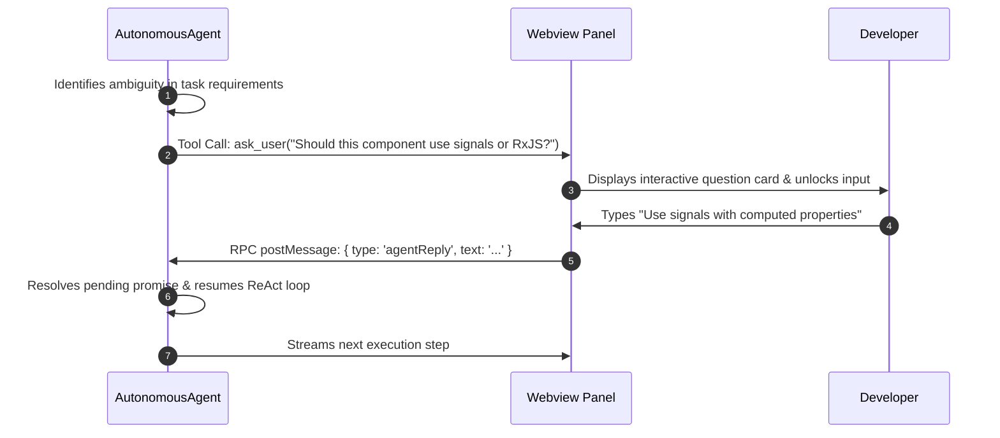

# Local Copilot Chat: Complete Technical Architecture & Specification

## 1. Executive Summary

**Local Copilot Chat** is a local-first, privacy-centric autonomous coding assistant built as a native Visual Studio Code extension. Inspired by GitHub Copilot Chat, Cursor Composer, and Claude Code, it runs 100% locally through [Ollama](https://ollama.com), requiring zero cloud connectivity or subscription keys.

### Key Milestones Delivered:
1. **Model Switcher & Ollama Bridge**: Dynamic dropdown querying `http://127.0.0.1:11434/api/tags` to seamlessly toggle between **`qwen3.5:9b`**, **`deepseek-r1:8b`**, and **`qwen2.5-coder:7b`**.
2. **DeepSeek Reasoning Accordion**: Native real-time streaming parser for `<think>` and `</think>` tags, encapsulating chain-of-thought tokens in a collapsible UI element.
3. **ChatGPT-Style Mode Switcher (`💬 Chat` vs `⚡ Agent`)**: Distinct UI separation between reactive streaming Q&A (no side-effects) and autonomous multi-turn ReAct problem solving.
4. **"Working..." Progress Accordion**: Real-time collapsing status card displaying live timeline steps (`🔄 Reading...`, `🛠️ Applying edit...`, `⚠️ Self-correcting LSP...`) culminating in `✅ Finished (X steps)`.
5. **Human-in-the-Loop "Pause & Ask" (`ask_user`)**: Autonomous agent can halt execution mid-task to seek clarification with inline question inputs or unlocked chat fields, resuming seamlessly on response.
6. **Workspace Context Scanner**: Intelligent directory tree crawler and manifest reader (`.slnx`, `.csproj`, `package.json`, `README.md`) with active editor selection extraction.
7. **Autonomous File Creation (`⚡ Auto-Write`)**: Regex-driven filename detector and one-click `[📄 Create File]` writer that directly creates and opens files on disk.
8. **Interactive Terminal Integration (`▶️ Run in Terminal`)**: Detects shell blocks (`dotnet`, `ng`, `npm`, `git`) and executes them directly in the VS Code terminal.
9. **Autonomous App Generator (`/create-app`)**: 7-stage autonomous planner that scaffolds and synthesizes complete full-stack .NET Web API + Angular applications from a single instruction.
10. **Claude Code ReAct Agent Engine (`autonomousAgent.ts`)**: Multi-turn autonomous loop (up to 20 iterations) executing tool detection, JSON function invocation, and result evaluation.
11. **Surgical Code Editor (`str_replace`)**: Fine-grained string replacement with uniqueness validation, eliminating hallucinated full-file overwrites.
12. **Native LSP Diagnostics & Self-Healing Loop**: Hooks into `vscode.languages.getDiagnostics()` after edits to capture C#/TypeScript compiler errors and autonomously patch them.
13. **Human-in-the-Loop Safety Tiering**: `⚡ Auto: ON` / `🛡️ Auto: OFF` toggle switch prompting developers with interactive `[Approve]` / `[Deny]` confirmation cards before destructive disk edits or command runs.
14. **Bundled Ripgrep Search**: Sub-second text and symbol search across large solutions using VS Code's internal `rg.exe` binary.
15. **Hierarchical Multi-Agent Swarm (`swarmOrchestrator.ts`)**: OpenAI Swarm & AutoGen-inspired swarm architecture with specialized personas (🧠 Orchestrator, 📋 Planner, 🧑‍💻 Coder, 🔬 Tester).
16. **VRAM Time-Slicing Sequential Execution**: Strict 8GB VRAM ceiling protection that swaps and unloads Ollama models (`keep_alive: 0`) between reasoning (`deepseek-r1:8b`) and synthesis (`qwen2.5-coder:7b`) without GPU memory overflow.
17. **Shared Memory Bus ("Whiteboard") & Sub-Agent Protocol**: Centralized objective, roadmap, scratchpad, and surgical delegation protocol using `delegate_task`, `hand_back`, and `finish_task`.
18. **RAG Long-Term Memory & Local Vector Store (`memoryService.ts`)**: 768-dimensional local vector store powered by `nomic-embed-text` with cosine similarity retrieval, offloading large context into the host's 32GB RAM.
19. **Persistent State Bus (.vscode/local-copilot/)**: Automatic serialization and hydration of `whiteboard.json` and `memory.json`, enabling seamless task resumption across IDE reloads.
20. **Bulletproof Segmented Mode Toggle Binding**: Direct DOM event binding for `#btn-mode-chat` and `#btn-mode-agent` updating `#chat-mode-label`, input placeholders, button labels, and passing `{ mode: currentMode }` across the RPC boundary to the Extension Host.
21. **Zero-Latency Heuristic Model Router (`modelRouter.ts`)**: Fast keyword intent classifier that auto-routes prompts without LLM inference delay—reasoning & architecture prompts map to `deepseek-r1:8b`, code synthesis & execution prompts map to `qwen2.5-coder:7b`, with seamless Agent Mode swarm delegation.
22. **Auto Model Selection (`⚡ Auto (Recommended)`)**: Pre-selected dropdown default that preserves dynamic Ollama model listings while guaranteeing optimal model assignment per prompt.

---

## 2. System Architecture

```mermaid
graph TD
    subgraph "VS Code Extension Host (Node.js)"
        Ext[extension.ts: Activation & Commands]
        CVP[ChatViewProvider: UI Manager & Event Router]
        
        subgraph "Hierarchical Swarm Core"
            Swarm[SwarmOrchestrator: State Machine & Router]
            Whiteboard[(Shared Memory Bus: Whiteboard)]
            Memory[MemoryService: Vector Store & RAG Engine]
            Registry[AgentRegistry: Personas & Tool Scoping]
            ATS[AgentToolService: Surgical Edits, Ripgrep, LSP Diagnostics]
            OS[OllamaService: Streaming, Tool Calling & VRAM Swapping]
        end

        subgraph "Swarm Personas (Sequential Time-Slicing)"
            P1[🧠 Orchestrator: Route, Delegate, Ask User, Memory]
            P2[📋 Planner: Architectural Checklists & Semantic Search]
            P3[🧑‍💻 Coder: Surgical str_replace & Auto-Index]
            P4[🔬 Tester: LSP Diagnostics & Build Audit]
        end

        Ext --> CVP
        CVP --> Swarm
        Swarm <--> Whiteboard
        Swarm <--> Memory
        Swarm --> Registry
        Registry --- P1
        Registry --- P2
        Registry --- P3
        Registry --- P4
        Swarm --> ATS
        Swarm --> OS
    end

    subgraph "Persistent Storage (.vscode/local-copilot/)"
        F1[(whiteboard.json<br/>State Persistence)]
        F2[(memory.json<br/>768-dim Vector Embeddings)]
    end

    subgraph "Local AI Runtime (Ollama Daemon - 8GB VRAM Sliced)"
        OLLAMA[localhost:11434]
        M1[(deepseek-r1:8b<br/>Orchestrator &amp; Planner)]
        M2[(qwen2.5-coder:7b<br/>Coder &amp; Tester)]
        M3[(qwen3.5:9b<br/>Unified Driver Fallback)]
        M4[(nomic-embed-text<br/>Fast Vector Embeddings)]
        OLLAMA --- M1
        OLLAMA --- M2
        OLLAMA --- M3
        OLLAMA --- M4
    end

    subgraph "Language Server & OS Host"
        LSP[VS Code Language Server Protocol<br/>C# OmniSharp / Roslyn / TS Server]
        RG[Bundled Ripgrep Binary: rg.exe]
        FS[Workspace Filesystem]
        Term[Integrated Terminal]
    end

    Whiteboard <-->|fs.writeFile / readFile| F1
    Memory <-->|fs.writeFile / readFile| F2
    ATS <-->|vscode.languages.getDiagnostics| LSP
    ATS <-->|execFile| RG
    ATS <-->|vscode.workspace.applyEdit / fs| FS
    CVP <-->|vscode.window.createTerminal| Term
    OS <-->|POST /api/chat & keep_alive:0| OLLAMA
    Memory <-->|POST /api/embeddings| OLLAMA
```



---

## 3. Detailed Component Architecture

### 3.1. Unified ReAct Agent Runtime ([`src/services/autonomousAgent.ts`](file:///c:/Projects/local-copilot-chat/src/services/autonomousAgent.ts))
Coordinates multi-turn reasoning and tool execution loops (bounded to `maxIterations = 20`):

```typescript
export class AutonomousAgent {
  public async executeTask(
    userGoal: string,
    callbacks: AgentCallbacks,
    signal?: AbortSignal
  ): Promise<string>
}
```

* **Phase 1: Architectural Planning**: Queries a reasoning model (`deepseek-r1:8b` or `qwen3.5:9b`) to plan the technical roadmap, parsing chain-of-thought tokens into `<details class="think-box">`.
* **Phase 2: Tool Execution Loop**: Queries the execution model with Ollama JSON-schema function definitions. When tool calls are emitted:
  1. Checks safety classification (`isDestructiveTool`).
  2. If non-autonomous, emits an interactive approval card to the Webview.
  3. Executes the action via `AgentToolService`.
  4. Inspects Language Server diagnostics.
  5. Feeds results back into conversation history as `{ role: 'tool', content: ... }`.
* **Context Compaction**: Monitors cumulative character length. When messages exceed ~45,000 characters (~11,000 tokens of the 16k window), intermediate tool outputs are compacted, preserving the system prompt, initial goal, and the latest turns.

---

### 3.2. Model Orchestration Matrix ([`src/services/ollamaService.ts`](file:///c:/Projects/local-copilot-chat/src/services/ollamaService.ts))

The extension dynamically selects the optimal model for each phase based on user selection and availability:

| User Selected Model | Phase 1: Planning / Root-Cause | Phase 2: Autonomous Tool Calling & Surgical Editing |
| :--- | :--- | :--- |
| **`qwen3.5:9b`** | **`qwen3.5:9b`** (Takes full control with its 9B reasoning capacity) | **`qwen3.5:9b`** (Unified driver for tool invocation, file editing, and verification) |
| **`deepseek-r1:8b`** | **`deepseek-r1:8b`** (Extracts deep chain-of-thought `<think>` reasoning) | **`qwen3.5:9b`** (or `qwen2.5-coder:7b` fallback for clean JSON tool adherence) |
| **`qwen2.5-coder:7b`** | **`deepseek-r1:8b`** (If installed, provides architecture plan) | **`qwen2.5-coder:7b`** (High-speed C# / TypeScript syntax synthesis) |

---

### 3.3. Surgical Code Editing Engine ([`src/services/agentToolService.ts`](file:///c:/Projects/local-copilot-chat/src/services/agentToolService.ts))

Replaces dangerous full-file overwrites with fine-grained operations:

| Tool Primitive | Signature | Functionality |
| :--- | :--- | :--- |
| **`view_file_range`** | `(filePath, startLine, endLine)` | Reads specific intervals with prepended `L<number>:` prefixes, minimizing context window consumption. |
| **`str_replace`** | `(filePath, oldStr, newStr)` | Surgically swaps exact unique blocks via `vscode.workspace.applyEdit`. Validates that `oldStr` exists and is unique; if ambiguous, returns line numbers of all occurrences. |
| **`apply_patch`** | `(filePath, patchContent)` | Parses unified diff hunks and applies changes. |
| **`create_file`** | `(filePath, content)` | Creates new files and missing parent directories using `vscode.workspace.fs.writeFile`. |
| **`search_workspace`** | `(query, maxResults)` | Runs VS Code's internal bundled `rg.exe` (Ripgrep) binary, falling back to `vscode.workspace.findFiles`. |
| **`execute_command`** | `(command)` | Runs terminal commands via `child_process.exec` in the workspace root with timeout handling. |
| **`get_diagnostics`** | `(filePath?)` | Inspects VS Code Language Server Protocol errors and warnings. |
| **`list_dir`** | `(dirPath?)` | Enumerates directory entries. |

---

### 3.4. Language Server Diagnostics & Self-Healing Loop

```mermaid
sequenceDiagram
    autonumber
    participant Agent as AutonomousAgent
    participant Tools as AgentToolService
    participant LSP as VS Code Language Server
    participant Model as Ollama Model

    Agent->>Tools: str_replace("TaskController.cs", oldStr, newStr)
    Tools->>Tools: applyEdit() & document.save()
    Tools->>LSP: vscode.languages.getDiagnostics(fileUri)
    
    alt Errors Detected
        LSP-->>Tools: [LSP Error] Line 48:12 - CS1002 ; expected
        Tools-->>Agent: Output + Diagnostic Alert
        Agent->>Agent: Inject error into message history
        Agent->>Model: Query model with compiler error
        Model-->>Agent: Tool call: str_replace to fix line 48
        Agent->>Tools: str_replace(fix)
    else Clean Build
        LSP-->>Tools: null (Zero errors)
        Tools-->>Agent: Output: Success
        Agent->>Model: Proceed to next step
    end
```

---

### 3.5. Human-in-the-Loop Safety & Confirmation Cards ([`src/providers/chatViewProvider.ts`](file:///c:/Projects/local-copilot-chat/src/providers/chatViewProvider.ts))

* **Autonomous Mode Toggle**: `⚡ Auto: ON` / `🛡️ Auto: OFF` in the header bar.
* **Safety Tiering**:
  * *Read-Only (Safe)*: `view_file_range`, `search_workspace`, `list_dir`, `get_diagnostics` run without prompting.
  * *Destructive*: `str_replace`, `create_file`, `apply_patch`, `execute_command` pause execution when in Approval Mode (`Auto: OFF`), displaying an interactive card:

```html
<div class="approval-card" id="approval-call_123">
  <div class="approval-header">⚠️ Confirmation Required: str_replace</div>
  <div class="approval-desc">Modify file: Backend.Api/Controllers/TaskController.cs</div>
  <div class="approval-actions">
    <button class="btn-approve" onclick="respondApproval('call_123', true)">Approve</button>
    <button class="btn-deny" onclick="respondApproval('call_123', false)">Deny</button>
  </div>
</div>
```

---

### 3.6. ChatGPT-Style Agent Mode UX & Pause-and-Ask Protocol

#### 1. Segmented Mode Controller (`Chat` vs `Agent`)
The webview header features a dual-segmented control toggle:
* **`💬 Chat` Mode**: Routes user prompts to `ollamaService.streamChat()`. Safe, read-only conversational assistant behavior with zero workspace side-effects.
* **`⚡ Agent` Mode**: Routes user prompts directly into `autonomousAgent.runTask()`. Unlocks native JSON function calling, file editing, diagnostic self-healing, and terminal execution.

#### 2. Real-Time "Working..." Progress Accordion
During autonomous execution in Agent Mode:
* A collapsible `<details class="working-accordion" open>` card renders above the response.
* As the agent reasons, inspects files, edits code, or runs commands, real-time events stream into an internal step list:
  * `🔄 Reading src/app.component.ts lines 1-45...`
  * `🛠️ Applied surgical edit to src/app.component.ts`
  * `⚠️ LSP detected TS2304: Cannot find name 'Item'. Self-correcting...`
* Upon task termination, the accordion automatically updates its header badge to `✅ Finished (X steps)` and closes, cleanly presenting the final answer below.

#### 3. Human-in-the-Loop Pause & Resume (`ask_user`)
When the model encounters architectural forks, missing specs, or ambiguity:
1. Model invokes the schema-defined tool `ask_user(question: string)`.
2. `autonomousAgent.ts` halts the ReAct loop and holds a pending `Promise<string>`.
3. An `askUser` event dispatches to the Webview, rendering a highlighted card with an inline input box and unlocking the main prompt input.
4. The user submits clarification, emitting `agentReply` back to the Extension Host.
5. The resolver unblocks, pushing `{ role: 'tool', name: 'ask_user', content: userAnswer }` into the message history, allowing the agent to resume execution without context loss.



---

### 3.7. Hierarchical Multi-Agent Swarm & VRAM Time-Slicing Protocol ([`src/services/swarmOrchestrator.ts`](file:///c:/Projects/local-copilot-chat/src/services/swarmOrchestrator.ts))

#### 1. The Swarm Persona Registry (`agentRegistry.ts`)
The multi-agent swarm decomposes complex software engineering objectives into specialized personas:

| Persona | Role | Model Assignment | Scoped Toolset | Responsibilities |
| :--- | :--- | :--- | :--- | :--- |
| **🧠 Orchestrator** | `orchestrator` | `deepseek-r1:8b` / `qwen3.5:9b` | `delegate_task`, `ask_user`, `finish_task`, `view_file_range`, `search_workspace`, `list_dir` | Primary router. Breaks user input down, coordinates delegations, pauses for human input, and evaluates final reports. |
| **📋 Planner** | `planner` | `deepseek-r1:8b` / `qwen3.5:9b` | `view_file_range`, `search_workspace`, `list_dir`, `hand_back` | Architecture analyst. Inspects workspace structure and formulates step-by-step Markdown checklists. |
| **🧑‍💻 Coder** | `coder` | `qwen2.5-coder:7b` / `qwen3.5:9b` | `str_replace`, `create_file`, `apply_patch`, `view_file_range`, `search_workspace`, `hand_back` | Execution engine. Performs surgical edits with uniqueness validation and generates code according to specs. |
| **🔬 Tester** | `tester` | `qwen2.5-coder:7b` / `qwen3.5:9b` | `get_diagnostics`, `execute_command`, `view_file_range`, `search_workspace`, `hand_back` | Auditor. Queries VS Code Language Server Protocol diagnostics and runs project build verification. |

#### 2. The Shared Memory Bus ("Whiteboard")
A persistent, centralized state machine tracks the life-cycle of the swarm across sequential turns:
* `userObjective`: The primary, inviolable user instruction.
* `executionPlan`: Architectural checklist synthesized by the Planner.
* `scratchpad`: Workspace discoveries, symbol mappings, and notes.
* `modifiedFiles`: Array of workspace files touched by the Coder.
* `delegationHistory`: Complete chronological audit of agent hand-offs and outcomes.
* `diagnostics`: Active compiler and linter diagnostics captured during test rounds.

#### 3. Sub-Agent Delegation Protocol
Communication between agents is strictly enforced through standard JSON function calling:
* **`delegate_task`**: Orchestrator hands a bite-sized task to a target agent (`planner`, `coder`, or `tester`), specifying `task_description` and `context_files`.
* **`hand_back`**: Sub-agents conclude their turn, returning control back to the Orchestrator with an outcome `status` (`success`, `failure`, `needs_clarification`) and a compact `result_summary`.
* **`finish_task`**: Orchestrator concludes the mission and delivers the final verified response.

#### 4. VRAM-Aware Model Time-Slicing (8GB GPU Ceiling)
Local consumer hardware typically cannot host both `deepseek-r1:8b` (5.2GB) and `qwen2.5-coder:7b` (4.7GB) simultaneously in 8GB VRAM without severe GPU out-of-memory errors and catastrophic disk swapping.
* The `SwarmOrchestrator` implements strict **sequential model time-slicing**.
* Only one model generates tokens at any given moment.
* When handing off between personas that utilize different models (e.g., from `deepseek-r1:8b` reasoning to `qwen2.5-coder:7b` execution), the engine calls `ollamaService.unloadModel(currentModel)` via `POST /api/generate` with `{ keep_alive: 0 }`.
* This immediately releases the 5GB of GPU memory before Ollama initializes the incoming model, ensuring zero memory leaks or OOM failures.

#### 5. Multi-Agent Nested UI & Persona Tracking
The Webview "Working..." progress accordion dynamically displays real-time agent hand-offs:
* Each timeline step renders a distinct colored badge identifying the active persona:
  * <span style="background: rgba(168,85,247,0.2); color:#c084fc; padding: 2px 6px; border-radius: 4px; font-weight:bold; font-size:10px;">🧠 SWARM ORCHESTRATOR</span>
  * <span style="background: rgba(59,130,246,0.2); color:#60a5fa; padding: 2px 6px; border-radius: 4px; font-weight:bold; font-size:10px;">📋 LEAD PLANNER</span>
  * <span style="background: rgba(16,185,129,0.2); color:#34d399; padding: 2px 6px; border-radius: 4px; font-weight:bold; font-size:10px;">🧑‍💻 SENIOR CODER</span>
  * <span style="background: rgba(245,158,11,0.2); color:#fbbf24; padding: 2px 6px; border-radius: 4px; font-weight:bold; font-size:10px;">🔬 QUALITY &amp; TEST AUDITOR</span>

---

### 3.8. RAG Long-Term Memory & Persistent State Bus ([`src/services/memoryService.ts`](file:///c:/Projects/local-copilot-chat/src/services/memoryService.ts))

#### 1. The Vector Memory Engine
To prevent polluting the active LLM context window (which must respect the 8GB VRAM constraint), Local Copilot Chat offloads knowledge into an in-memory vector store hosted in the workstation's 32GB system RAM:
* **Model**: Leverages Ollama's `nomic-embed-text` (768 dimensions, ~274MB memory footprint) via `POST /api/embeddings`.
* **Fallback Strategy**: Deterministic 768-dimensional token n-gram feature hashing ensures searching and indexing never crash even if Ollama is temporarily offline.
* **Storage Location**: Serialized strictly to `.vscode/local-copilot/memory.json` in the active workspace.
* **Auto-Indexing Pipeline**: When the Coder creates or edits files (`create_file`, `str_replace`), the content is automatically chunked into overlapping ~1200-character blocks and indexed in the background.

#### 2. Vector Math: Cosine Similarity
Relevance scoring utilizes the cosine angle between query and document vectors:
$$\text{Similarity}(A, B) = \frac{\sum_{i=1}^{n} A_i B_i}{\sqrt{\sum_{i=1}^{n} A_i^2} \cdot \sqrt{\sum_{i=1}^{n} B_i^2}}$$
Ranked results are returned with similarity percentage and source metadata (`filePath`, `agentOrigin`, `category`).

#### 3. Persistent Whiteboard (.vscode/local-copilot/whiteboard.json)
The central swarm state bus is automatically saved to disk upon every mutation:
* When `delegate_task` is called, the delegation history is committed.
* When sub-agents call `hand_back`, modified files, execution roadmaps, and diagnostics are serialized.
* On IDE restart, the Swarm Orchestrator checks `.vscode/local-copilot/whiteboard.json` and automatically rehydrates past roadmaps and modified file sets.

#### 4. New Memory Tools in Agent Registry
* **`semantic_search(query, limit?, category?)`**: Queries the vector store for top-K matching code chunks, architectural decisions, or user preferences.
* **`store_memory(content, category, tags?)`**: Explicitly stores decisions, rules, or preferences (`category: 'decision' | 'architecture' | 'preference' | 'plan' | 'code'`).

#### 5. Webview Memory Status Indicator
A live status pill in the controls row indicates active indexing:
* Displays `💾 Memory: Active` or item count badge (`💾 Memory: 12 items`).

### 3.7 Auto-Model Routing & Webview State Architecture

#### 1. Zero-Latency Heuristic Intent Classifier (`modelRouter.ts`)
To eliminate LLM inference latency, token usage, and VRAM thrashing just to pick a model, `ModelRouter` runs regex word-boundary pattern matching against prompt semantics:
* **Reasoning / Architecture Rule**:
  - Keywords: `why`, `explain`, `design`, `architect`, `architecture`, `plan`, `debug`, `trace`, `analyze`, `structure`, `how does`, `compare`, `difference`, `review`, `audit`, `evaluate`, `investigate`, `root cause`.
  - Optimal Model: **`deepseek-r1:8b`** (with `<think>` reasoning chain).
* **Coding / Execution Rule**:
  - Keywords: `write`, `generate`, `create`, `fix`, `refactor`, `add`, `component`, `endpoint`, `implement`, `code`, `function`, `class`, `method`, `patch`, `controller`, `service`, `html`, `css`, `typescript`, `csharp`, `dotnet`, `angular`, `unit test`, `test`, `syntax`, `bug`, `error`.
  - Optimal Model: **`qwen2.5-coder:7b`** (precise syntax, surgical tool calling).
* **Agent Mode Override**:
  - Automatically routes to the Swarm Orchestrator's entry model (DeepSeek-R1 or Qwen 3.5), allowing the multi-agent state machine to time-slice models across execution turns.
* **Fallback Priority**:
  - Respects locally installed Ollama tags (e.g. `qwen3.5:9b` if available).

#### 2. Bulletproof Webview DOM & RPC Contract
The Webview frontend architecture synchronizes UI elements with the extension runtime:
* **Explicit Element IDs**:
  - `#btn-mode-chat`: Activates standard Chat Mode.
  - `#btn-mode-agent`: Activates autonomous Swarm Agent Mode.
  - `#modelSelect`: Dropdown with `⚡ Auto (Recommended)` as the top option, persisted even after dynamic model refreshes via `modelsList`.
  - `#chat-mode-label`: Displays active mode state (`💬 Chat Mode` vs `⚡ Agent Mode`).
  - `#chatInput`: Dual-purpose auto-expanding prompt input.
* **Two-Way RPC Contract**:
  - Frontend dispatch:
    ```javascript
    vscode.postMessage({
      type: 'sendMessage',
      text: userPrompt,
      model: modelSelect.value, // 'Auto' or specific model
      mode: currentMode,        // 'chat' or 'agent'
      autonomousMode: isAutonomous
    });
    ```
  - Backend dispatch (`ChatViewProvider._handleSendMessage`):
    Resolves `Auto` to the optimal model via `ModelRouter.route()`, notifies the webview with `startStream` displaying `${resolvedModel} (Auto)`, and dispatches execution to either `streamChat` or `SwarmOrchestrator.runTask`.

---

## 4. Command & Slash Action Reference

| Command / Control | Mode | Behavior |
| :--- | :--- | :--- |
| **`/create-app <idea>`** | Planner | Launches `AppGeneratorService` to scaffold and write a complete .NET API + Angular solution. |
| **`/build` or `/fix`** | Diagnostic | Executes `dotnet build` or `npm run build`, captures error logs, and prompts the agent to self-heal. |
| **`/diff`** | Audit | Executes `git diff --stat` & `git status --short` to inspect pending changes. |
| **`/commit`** | Git | Analyzes git diffs to generate 3 conventional commit message options. |
| **`/search <term>`** | Search | Performs ripgrep search across workspace files. |
| **`/read <path>`** | Inspection | Reads the specified file with line numbers directly into context. |
| **`📌 Selection`** | Quick Action | Injects active editor highlighted text formatted as markdown. |
| **`📄 Active`** | Quick Action | Injects the complete open editor document. |
| **`📁 Project`** | Quick Action | Attaches the project directory tree and manifest summaries. |
| **`▶️ Run in Terminal`** | Code Block | Sends generated shell commands to the `Local Copilot` terminal. |

---

## 5. Security, Privacy & Air-Gap Audit

* **100% Offline**: All inference runs locally via `http://127.0.0.1:11434`. Zero external network calls or telemetry exist in the extension code.
* **Webview Isolation**: All scripts run inside a sandboxed iframe with strict `localResourceRoots` boundaries.
* **Terminal Transparency**: Commands run in an open, visible integrated terminal named `Local Copilot` rather than hidden background processes.
