# Local Copilot Chat: Complete Technical Architecture & Specification

## 1. Executive Summary

**Local Copilot Chat** is a local-first, privacy-centric autonomous coding assistant built as a native Visual Studio Code extension. Inspired by GitHub Copilot Chat, Cursor Composer, and Claude Code, it runs 100% locally through [Ollama](https://ollama.com), requiring zero cloud connectivity or external API subscription keys.

### Key Architectural Capabilities Delivered:
1. **Model Switcher & Dynamic Ollama Bridge**: Dynamic dropdown querying `http://127.0.0.1:11434/api/tags` to seamlessly toggle between models (`qwen3.5:9b`, `deepseek-r1:8b`, `qwen2.5-coder:7b`) with connection health state badges (`🟢 Online`, `🔄 Connecting...`, `🟡 No Models`, `🔴 Offline`), actionable retry banners, and stale response discard.
2. **DeepSeek Reasoning Accordion & Streaming Thought Separation**: Intercepts `<think>` and `</think>` tags in real time during streaming, encapsulating chain-of-thought tokens inside a collapsible `<details class="think-box">` UI element while keeping user-facing text clean.
3. **ChatGPT-Style Mode Switcher (`💬 Chat` vs `⚡ Agent`)**: Clear UI separation between reactive streaming Q&A (no side-effects) and autonomous multi-turn ReAct problem solving.
4. **"Working..." Progress Accordion**: Real-time collapsing status card displaying live timeline steps (`🔄 Reading...`, `🛠️ Applying edit...`, `⚠️ Self-correcting LSP...`) culminating in `✅ Finished (X steps)`.
5. **Human-in-the-Loop "Pause & Ask" (`ask_user`)**: Autonomous agent can halt execution mid-task to seek clarification with inline question inputs or unlocked chat fields, resuming seamlessly on response.
6. **Workspace Context Scanner**: Intelligent directory tree crawler and manifest reader (`.slnx`, `.csproj`, `package.json`, `README.md`) with active editor selection extraction.
7. **Autonomous File Creation (`⚡ Auto-Write`)**: Regex-driven filename detector and one-click `[📄 Create File]` writer that directly creates and opens files on disk.
8. **Interactive Terminal Integration (`▶️ Run in Terminal`)**: Detects shell blocks (`dotnet`, `npm`, `git`) and executes them directly in the VS Code terminal.
9. **Autonomous App Generator (`/create-app`)**: 7-stage autonomous planner that scaffolds and synthesizes complete full-stack .NET Web API + Angular applications from a single instruction.
10. **Claude Code ReAct Agent Engine (`autonomousAgent.ts`)**: Multi-turn autonomous loop executing tool detection, JSON function invocation, and result evaluation.
11. **Surgical Code Editor (`str_replace`)**: Fine-grained string replacement with uniqueness validation, eliminating hallucinated full-file overwrites.
12. **Native LSP Diagnostics & Self-Healing Loop**: Hooks into `vscode.languages.getDiagnostics()` after edits to capture C#/TypeScript compiler errors and autonomously patch them.
13. **Human-in-the-Loop Safety Tiering**: `⚡ Auto: ON` / `🛡️ Auto: OFF` toggle switch prompting developers with interactive `[Approve]` / `[Deny]` confirmation cards before destructive disk edits or command runs.
14. **Bundled Ripgrep Search**: Sub-second text and symbol search across large solutions using VS Code's internal `rg.exe` binary.
15. **Hierarchical Multi-Agent Swarm (`swarmOrchestrator.ts`)**: OpenAI Swarm & AutoGen-inspired swarm architecture with specialized personas (🧠 Orchestrator, 📋 Planner, 🧑‍💻 Coder, 🔬 Tester).
16. **VRAM Time-Slicing Sequential Execution**: Strict 8GB VRAM ceiling protection that swaps and unloads Ollama models (`keep_alive: 0`) between reasoning (`deepseek-r1:8b`) and synthesis (`qwen2.5-coder:7b`) without GPU memory overflow.
17. **Shared Memory Bus ("Whiteboard") & Sub-Agent Protocol**: Centralized objective, roadmap, scratchpad, and surgical delegation protocol using `delegate_task`, `hand_back`, and `finish_task`.
18. **RAG Long-Term Memory & Local Vector Store (`memoryService.ts`)**: 768-dimensional local vector store powered by `nomic-embed-text` with cosine similarity retrieval, offloading large context into the host's 32GB RAM.
19. **Persistent State Bus (.vscode/local-copilot/)**: Automatic serialization and hydration of `whiteboard.json` and `memory.json`, enabling seamless task resumption across IDE reloads.
20. **Zero-Latency Heuristic Model Router (`modelRouter.ts`)**: Fast keyword intent classifier that auto-routes prompts without LLM inference delay—reasoning & architecture prompts map to `deepseek-r1:8b`, code synthesis & execution prompts map to `qwen2.5-coder:7b`, with seamless Agent Mode swarm delegation.
21. **Code Block UX & Clipboard Fallback**: Prominent `📋 Copy` button with temporary `✓ Copied!` checkmark feedback, comprehensive language-to-extension dictionary mapping, and extension host clipboard fallback.
22. **Runtime Configuration Architecture (`configurationService.ts`)**: Centralized single source of truth managing `numCtx` (default 16384), `temperature` (default 0.2), and `maxTurns` (default 25) with clamping, validation, live change events, and a deterministic tool-calling temperature ceiling $\le 0.1$.
23. **Security Hardening (Phase 1)**: Filesystem boundary resolution (`resolveSecurePath`), Windows NTFS directory junction and symlink containment, 4-tier command classification (`CommandClassifier`), host executable resolution (`ExecutableResolver`), Git execution isolation (`GitExecutionIsolator`), strict Webview Content Security Policy, and message schema validation (`MessageValidator`).
24. **Evidence Verification Gate & Loop Breaker (Phase 3)**: Orchestrator rejects premature `finish_task` calls if files were modified until the `tester` sub-agent reviews diagnostics and confirms workspace stability. Consecutive identical sub-agent tool call loops are automatically terminated.
25. **Persistent Conversation History (Phase 5)**: User and agent conversation turns are automatically saved to `.vscode/local-copilot/chat_history.json` and rehydrated upon extension startup.
26. **Conversation Context Manager & Referential Objective Resolution (`conversationContextManager.ts`)**: Token-budgeted prior conversation context window (last N turns verbatim + deterministic older turn summary), trust partitioning (user turns trusted, tool output tagged untrusted), and automatic resolution of referential follow-ups ("actually implement the changes") against previous assistant proposals.
27. **Code-Dump Enforcement & Multi-Phase Decomposition**: Prevents premature completion when an assistant outputs code blocks into chat with 0 disk writes on implementation requests; automatically decomposes multi-phase specs into isolated sequential single-phase executions.

---

## 2. System Architecture

```mermaid
graph TD
    subgraph "VS Code Extension Host (Node.js)"
        Ext[extension.ts: Activation & Lifecycle]
        Config[ConfigurationService: Settings & Event Emitters]
        CVP[ChatViewProvider: UI Manager & Event Router]
        Val[MessageValidator: RPC Contract Validation]
        
        subgraph "Security Boundary Layer"
            SecPath[resolveSecurePath: Symlink & Junction Guards]
            CmdClass[CommandClassifier: 4-Tier Security Matrix]
            ExeRes[ExecutableResolver: Host Binary Resolution]
            GitIso[GitExecutionIsolator: Argument & Env Sanitizer]
        end

        subgraph "Hierarchical Swarm Core"
            Swarm[SwarmOrchestrator: State Machine & Router]
            Whiteboard[(Shared Memory Bus: Whiteboard)]
            Memory[MemoryService: Vector Store & RAG Engine]
            Registry[AgentRegistry: Personas & Tool Scoping]
            ATS[AgentToolService: Surgical Edits, Ripgrep, LSP Diagnostics]
            OS[OllamaService: Streaming, Tool Calling & VRAM Swapping]
        end

        subgraph "Swarm Personas (Sequential Time-Slicing)"
            P1[🧠 Orchestrator: Route, Delegate, Ask User, Memory]
            P2[📋 Planner: Architectural Checklists & Semantic Search]
            P3[🧑‍💻 Coder: Surgical str_replace & Auto-Index]
            P4[🔬 Tester: LSP Diagnostics & Build Audit]
        end

        Ext --> Config
        Ext --> CVP
        CVP --> Val
        Val --> CVP
        CVP --> Swarm
        Swarm <--> Whiteboard
        Swarm <--> Memory
        Swarm --> Registry
        Registry --- P1
        Registry --- P2
        Registry --- P3
        Registry --- P4
        Swarm --> ATS
        ATS --> SecPath
        ATS --> CmdClass
        ATS --> ExeRes
        ATS --> GitIso
        Swarm --> OS
    end

    subgraph "Persistent Storage (.vscode/local-copilot/)"
        WB_JSON[whiteboard.json: Roadmap & Delegation Bus]
        MEM_JSON[memory.json: 768-dim Vector Embeddings]
        HIST_JSON[chat_history.json: Multi-Session Chat Logs]
    end

    Whiteboard <--> WB_JSON
    Memory <--> MEM_JSON
    CVP <--> HIST_JSON

    subgraph "Ollama Engine (Localhost :11434)"
        R1[deepseek-r1:8b: Reasoning]
        QwenCoder[qwen2.5-coder:7b: Tool Calling]
        Embed[nomic-embed-text: 768-dim Embeddings]
    end

    OS <--> R1
    OS <--> QwenCoder
    Memory <--> Embed
```



---

## 3. Subsystem Specifications

### 3.1 Security Architecture (Phase 1)

#### 1. Filesystem Containment (`AgentToolService.resolveSecurePath`)
- **Traversal Prevention**: Rejects relative path segments `..`, null bytes, and UNC paths (`\\server\share`) prior to normalization.
- **Physical Symlink & Junction Guards**: Employs `fs.realpathSync` to ensure symbolic links and Windows NTFS directory junctions resolve within the active workspace root.
- **Internal State Protection**: Forbids agent tools from accessing `.vscode/local-copilot/` directly; internal storage is exclusively accessible through `AgentToolService.getTrustedInternalStateUri`.
- **Multi-Root Workspace Determinism**: Requires paths in multi-root workspaces to explicitly designate the target root folder name, preventing ambiguous writes.

#### 2. Command Execution Security (`CommandClassifier`, `ExecutableResolver`, `GitExecutionIsolator`)
- **4-Tier Command Matrix**:
  - **Tier 1 (Safe Read-Only)**: `git status`, `git diff` (whitelisted flags), `git log`, tool version queries (`node --version`). Executed without approval.
  - **Tier 2 (Project Execution)**: `npm test`, `npm start`, `dotnet build`, `dotnet test`, `pytest`. Requires approval in non-autonomous and autonomous modes.
  - **Tier 3 (Arbitrary & Mutating)**: `npm install`, `npx`, `dotnet add`, mutating Git commands (`git commit`, `git checkout`). Requires approval unconditionally.
  - **Tier 4 (Prohibited)**: Shell scripts (`.bat`, `.cmd`, `.ps1`, `.vbs`, `.sh`), interactive shells (`bash`, `pwsh`, `cmd`), privilege escalation (`sudo`, `runas`), downloaders (`curl`, `wget`), and destructive disk tools (`rm -rf`, `format`). Fail-closed rejection.
- **Non-Shell Spawn**: Commands run with `child_process.spawn(..., { shell: false })` to eliminate shell injection vulnerabilities.
- **Git Isolation**: Injects `--no-pager`, `--no-ext-diff`, and `--no-textconv`. Sanitizes environment variables with `GIT_CONFIG_COUNT=0`, `GIT_OPTIONAL_LOCKS=0`, and `GIT_TERMINAL_PROMPT=0`.

#### 3. Webview Content Security Policy & Message Validation
- **CSP Restrictions**: Meta tag restricts resource loading to `default-src 'none'`.
- **Message Contracts (`MessageValidator`)**: Strictly typed validator verifying incoming webview messages against an allowed type whitelist and validating payload parameters. Dispatches `rpcError` on malformed messages.

---

### 3.2 Runtime & Configuration Architecture (Deliverable A & Phase 2)

#### 1. Configuration Service (`ConfigurationService.ts`)
A centralized singleton manages all VS Code user settings:
- `localCopilot.numCtx` (default: 16384, bounds: 2048–65536)
- `localCopilot.temperature` (default: 0.2, bounds: 0.0–1.0)
- `localCopilot.maxTurns` (default: 25, bounds: 1–100)
- `localCopilot.ollamaEndpoint` (default: `http://127.0.0.1:11434`)
- `localCopilot.defaultModel` (default: `qwen2.5-coder:7b`)

#### 2. Deterministic Tool Temperature Ceiling
While conversational chat uses user-configured temperature (0.2), all agent and swarm tool-calling invocations enforce a strict deterministic ceiling:
$$\text{Tool Temperature} = \min(\text{temperature}, 0.1)$$
This ensures consistent JSON formatting and deterministic tool parameters.

#### 3. Dynamic Context Compaction
When message history length exceeds context capacity, history is dynamically compacted using:
$$\text{Threshold Chars} = \lfloor \text{numCtx} \times 2.5 \rfloor$$

---

### 3.3 Agent Swarm & Delegation Protocol (Phase 3)

#### 1. Specialized Agent Personas
- **🧠 Orchestrator**: High-level workflow planning, user interaction (`ask_user`), task delegation (`delegate_task`), and memory persistence.
- **📋 Planner**: Architectural roadmaps, file structure analysis, semantic search.
- **🧑‍💻 Coder**: Surgical file editing (`str_replace`), file creation (`create_file`), patch application (`apply_patch`).
- **🔬 Tester**: LSP diagnostics auditing (`get_diagnostics`), build checking (`check_build`), test execution.

#### 2. Evidence Verification Gate
If workspace files were modified during a swarm session, the orchestrator is blocked from concluding the task prematurely. It must delegate to `tester` to verify diagnostics and build results before `finish_task` is accepted.

#### 3. Repetition Loop Defense
The orchestrator maintains an execution signature buffer. If a sub-agent executes the identical tool with identical parameters 3 consecutive times, the loop is broken and control is returned to the orchestrator with an execution failure report.

---

### 3.4 Long-Term Memory & Persistent RAG (Phase 4)

#### 1. Indexing & Exclusion Rules (`MemoryService.isIndexableFile`)
Strictly rejects:
- Sensitive secrets: `.env*`, `.pem`, `.key`, `id_rsa`, `id_ed25519`, `credentials.json`, `secrets.json`.
- Build output & dependencies: `node_modules`, `.git`, `.vscode`, `dist`, `bin`, `obj`, `target`.
- Binaries & media: `.png`, `.jpg`, `.zip`, `.exe`, `.dll`, `.so`.

#### 2. Stale Chunk Pruning & Deduplication
- When files are modified or deleted, existing chunks are pruned via `removeFileChunks`.
- Semantic search results are deduplicated across identical chunk content and file origins.

#### 3. Corruption Recovery
Corrupted state files (`memory.json`, `whiteboard.json`) are automatically quarantined to `.corrupt` backup files, and in-memory stores are initialized cleanly without throwing unhandled exceptions.

---

### 3.5 Webview & Streaming UX (Deliverable A.2 & Phase 5)

#### 1. Code Block Copy UX & Language Mapping
- `📋 Copy` button with temporary visual feedback (`✓ Copied!`) for 1.8 seconds.
- Multi-tier clipboard resolution: browser `navigator.clipboard` with fallback to `vscode.env.clipboard.writeText` via extension host RPC.
- Language mapping dictionary mapping aliases (`csharp` $\to$ `.cs`, `python` $\to$ `.py`, `typescript` $\to$ `.ts`).

#### 2. Real-Time Thought Stream Separation
- `<think>...</think>` tokens emitted during DeepSeek-R1 streaming are separated from message bubbles.
- Thoughts stream dynamically into an interactive `<details class="think-box"><summary>💭 Thought process</summary><div class="think-content">...</div></details>` disclosure.

#### 3. Conversation History Restoration
- Chat turns are serialized to `.vscode/local-copilot/chat_history.json`.
- Sessions are rehydrated on webview initialization and cleared when the user triggers `clearChat`.

---

## 4. Phase 5.5 (H1) Production Hardening

All Critical defects (DEFECT-CRIT-01 and DEFECT-CRIT-02) and operational process safety requirements have been implemented and verified:

### 1. [DEFECT-CRIT-01] Command De-chaining & Internal Caller Audit
- **`AppGeneratorService.generateFullStackApp`**: Eliminated shell chaining `&&` and shell builtin `cd`. Replaced with sequential individual calls targeting `Backend.Api/Backend.Api.csproj` directly without directory changes.
- **`AgentToolService.getGitDiff`**: Decoupled `git diff --stat` and `git status --short`. Formats output cleanly when clean or uninitialized.
- **Internal Callers**: Audited all `executeCommand` invocations in `checkBuild()`, `getGitDiff()`, `AppGeneratorService`, `AutonomousAgent`, and `SwarmOrchestrator` to ensure zero shell metacharacter usage while preserving legitimate argument boundaries.

### 2. [DEFECT-CRIT-02] Windows Node.js & Package Manager Resolution (No Shell)
- **Eliminated Shell Fallbacks**: Completely removed `ComSpec` and `findTrustedCmd`. No `cmd.exe /c` or `{ shell: true }` is ever used.
- **Trusted Roots & Multi-Layout Inspection**: Enhanced `findNodeAndNpmCli` to canonicalize search roots and locate `node.exe` with `npm-cli.js` / `npx-cli.js` across standard installer, NVM Windows, Volta, fnm, and global npm (`%APPDATA%\npm`).
- **Strict Anti-Hijack Policy**: Reject any binary or CLI script residing inside or beneath active workspace folders.
- **Verified Offline Real-Process Execution**: Validated `npm --version` and `npx --version` on Windows using real `node.exe` with `shell: false`.

### 3. Stream Turn Ownership & Centralized Lifecycle
- **Turn Ownership**: Tagged each turn with a generation ID (`_currentGenerationId = ++_generationCounter`). Exit paths only mutate state or emit events if their generation ID matches the active generation ID, preventing race conditions from terminating newly started streams.
- **Centralized Exactly-Once `streamEnd`**: The outer `finally` block dispatches `streamEnd` once per turn across success, error, and cancellation paths.
- **Slash Command Routing**: Handled `/diff`, `/create-app`, and `/build`. Intercepted reserved commands (`/fix`, `/commit`, `/search`, `/read`) with clear user guidance rather than silently falling through to normal LLM conversation.

---

## 5. Phase 5.5 (H2) High-Severity Hardening

All High-severity defects (DEFECT-HIGH-01, DEFECT-HIGH-02, and DEFECT-HIGH-03) have been implemented and verified:

### 1. [DEFECT-HIGH-01] Webview CSP Nonce Enforcement, Zero Inline Handlers & Context-Specific XSS Defense
- **Strict Nonce Enforcement**: Verified cryptographic 16-byte base64 nonces on `script-src` and complete exclusion of `'unsafe-inline'` and `'unsafe-eval'`.
- **Zero Inline Event Attributes**: Replaced direct property event assignments (`tab.onclick = ...`) in favor of strict `addEventListener` and delegation. Verified HTML contains strictly zero `on*` inline event attributes.
- **Context-Specific Template Sanitization**:
  - HTML text content escaped via `escapeHtml()`.
  - Dynamic `icon` in `appendTimelineStep` escaped via `escapeHtml(icon)`.
  - Class name `agentRole` sanitized into strict alphanumeric slugs (`/[^a-z0-9_-]/g`), eliminating DOM attribute escapes and CSS injection.
- **XSS Corpus Verification**: Verified neutralization of `<script>`, ``, `<svg onload>`, `javascript:`, and quote breakages across dynamic webview sinks.

### 2. [DEFECT-HIGH-02] Swarm Whiteboard Schema v2, Task Identity & Evidence Verification Isolation
- **Schema v2**: Introduced `SwarmWhiteboard` Schema v2 featuring per-task identity (`taskId`), `currentTask`, `lastTask`, and `projectContext`.
- **Task-Local State Isolation**: New tasks (`isContinuation: false`) archive previous task to `lastTask` and generate a fresh `taskId`, resetting `modifiedFiles = []`, `executionPlan = ''`, `diagnostics = []`, and `delegationHistory = []`.
- **Read-Only Task Immunity**: Evidence verification on `finish_task` checks only files modified in the *current* task session. Read-only queries are never trapped by edits from earlier tasks.
- **Seamless v1 Legacy Migration**: `loadWhiteboardFromDisk()` detects legacy unversioned files and migrates them to Schema v2 without data loss or corruption.

### 3. [DEFECT-HIGH-03] Concurrent Generation Single-Flight Guard & Ownership Cleanup
- **Single-Flight Lock**: `_handleSendMessage` rejects incoming generation requests immediately if `_isGenerating === true`, posting an actionable `streamError` without corrupting history or aborting in-flight work.
- **History Preservation**: Rejected messages are never appended to `_chatHistory`.
- **Generation Ownership of Lock & Cleanup**: `stopGeneration` aborts `_currentAbortController` without prematurely resetting `_isGenerating = false`. Each generation exclusively owns its cleanup in its own `finally` block guarded by `_currentGenerationId === generationId`.
- **Race Condition Immunity Verified**: Verified with dedicated regression tests that an earlier aborted generation unwinding asynchronously in the background never clobbers a newer generation's state, controllers, or locks.
- **Unblocked `ask_user` Clarifications**: `agentReply` messages route directly to `_currentAgent.resume()` without passing through the single-flight send guard.

---

## 6. Phase 5.5 (H3) Medium-Severity Hardening (Completed & Verified)

All four medium-severity audit defects have been fully implemented, integrated, and verified with 197 passing unit tests:

1. **[DEFECT-MED-01] Shared AtomicFileWriter (`src/services/atomicFileWriter.ts`)**:
   - Centralized atomic write service using temp files (`.tmp.[pid].[timestamp].[rand]`), incorporating `process.pid` to avoid multi-process collisions.
   - Mutex queue (`writeQueue`) per target URI guaranteeing sequential in-order file replacements.
   - Automatic cleanup of stale temporary files older than 60 seconds (`cleanupStaleTempFiles`).
   - Resilient `readJson` with automatic `.corrupt` file backup upon JSON parse failure, falling back safely without unhandled crashes.
   - Fully adopted across `MemoryService`, `SwarmOrchestrator`, and `ChatViewProvider`.

2. **[DEFECT-MED-02] Universal <think> Token Suppression (`src/providers/chatViewProvider.ts`)**:
   - Robust `stripThoughtTokens` utility handling multiline, case-insensitive, and trailing unclosed `<think>` tags (`/(?:<\/think>|$)/gi`).
   - Clean separation of live thinking in `<details class="think-box">` from persisted message content.
   - Stripped in both standard chat and agent mode save paths, and sanitized on history restoration from disk.

3. **[DEFECT-MED-03] Host-Side Modal Approval for Terminal Execution (`src/providers/chatViewProvider.ts`)**:
   - Classifies commands via `CommandClassifier`. Tier 4 commands are prohibited outright.
   - Requires host modal confirmation (`vscode.window.showWarningMessage` with `{ modal: true }`) for **Tier 2** (`npm test`, `dotnet run`) and **Tier 3** (arbitrary execution) commands before terminal execution.
   - Blocks terminal execution completely in untrusted workspaces (`vscode.workspace.isTrusted === false`).

4. **[DEFECT-MED-04] Comprehensive Git Environment & Config Isolation (`src/services/gitExecutionIsolator.ts`, `src/services/agentToolService.ts`)**:
   - Injected config overrides into Git invocations: `-c core.hooksPath=/dev/null`, `-c diff.external=`, `-c merge.tool=`, `-c diff.tool=`.
   - Injected `GIT_CONFIG_NOSYSTEM=1` environment variable.
   - Enforced Workspace Trust gating in `AgentToolService.executeCommand`, restricting untrusted workspaces to read-only Tier 1 commands.

---

## 7. Phase 7: Production Integration & Security Remediation

Phase 7 transformed all Phase 5.5 and Phase 6 autonomous capabilities into unified, production-grade functionality:

1. **Path Security & Conflict-Aware Rollbacks (`src/services/pathSecurity.ts`, `src/services/codeGenerationEngine.ts`)**:
   - Centralized `PathSecurity.validatePath` handling traversal detection, null bytes, UNC path rejection, internal state boundary defense, and symlink/junction canonicalization.
   - `CodeGenerationEngine` snapshotting pre-flight file bytes and computing SHA-256 hashes to detect concurrent user modifications and perform conflict-aware rollbacks without clobbering external changes.

2. **External Model Protection & Ownership Tracking (`src/services/modelLifecycleManager.ts`)**:
   - Tracks models explicitly loaded by this extension instance (`_extensionOwnedModels`).
   - Never unloads models in Ollama's global `/api/ps` table belonging to external processes (Open WebUI, CLI tools, other editors) unless explicitly instructed.

3. **Autonomous Debugging & Real-Time `/fix` Workflow (`src/services/autonomousDebuggerService.ts`, `src/providers/chatViewProvider.ts`)**:
   - End-to-end slash command `/fix [errorText]`: captures stack trace/diagnostics, localizes culprit file via `PathSecurity`, prompts local LLM for minimal surgical replacement, applies patch transactionally via `CodeGenerationEngine`, and verifies build with automatic rollback if failed.

4. **Safe Multi-File Code Generation Tooling (`src/services/agentToolService.ts`, `src/services/autonomousAgent.ts`)**:
   - Registered `apply_transactional_patches` tool in `AVAILABLE_TOOLS` and `AutonomousAgent`, executing atomic multi-file creations, modifications, and deletions with automatic rollback.

5. **Autonomous Orchestration Handlers (`src/services/autonomousOrchestrator.ts`)**:
   - Default production handlers connecting `Architect` -> `Developer` -> `Tester` -> `Reviewer` roles to real Ollama LLM prompting with bounded iterations and review criteria checks.

6. **Regression Intelligence Transitive Tracing & Safety Escalation (`src/services/regressionIntelligenceService.ts`)**:
   - Graph traversal tracking transitive dependents across workspace files.
   - Safety escalation: if no tests are found for a modified file or dependency analysis is uncertain, escalates to full test suite (`requiresFullSuite: true`).

7. **Full Slash Command Suite & Source Control Hygiene (`src/providers/chatViewProvider.ts`, `src/services/workspaceManager.ts`)**:
   - Live `/search` and bounded `/read` with path security.
   - `/benchmark`: built-in evaluation battery across 4 core competencies.
   - Reviewable `/commit` displaying changed files, diff stat, and requiring explicit user confirmation before committing.
   - `WorkspaceManager.ensureStorageHygiene` writing `.vscode/local-copilot/.gitignore` to keep internal whiteboards and diagnostics isolated from source control.

---

## 8. Phase 9 & 10 Advanced Architecture & Services

### Phase 9: Agent Intelligence & Coding Quality
1. **Standardized 30-Task Benchmark Corpus (`src/services/benchmarkTaskCorpus.ts`)**:
   - 10 code repair, 8 feature generation, 6 refactor, and 6 tool use tasks specifically designed for local 7B-9B models.
   - Automated comparison engine tracking pass-rate deltas and per-category improvements.
2. **Tolerant JSON Parsing & Conversation Compactor (`src/services/tolerantJsonParser.ts`, `src/services/contextCompactionService.ts`)**:
   - 4-stage tolerant repair: markdown fences, syntax normalization (trailing commas, unquoted keys, single quotes), and stack-based bracket balancing for truncated outputs.
   - Structured conversation compaction generating `<CONTEXT_SUMMARY>` preserving goals, referenced files, operations, and diagnostics.
3. **Incremental Low-Token Repository Map (`src/services/repositoryMapService.ts`)**:
   - Degree-centrality scoring across imported and exported symbols.
   - Atomic caching to `.vscode/local-copilot/repo-map.json` using content hashes and modification timestamps.
4. **Dynamic Context Budget Manager (`src/services/contextBudgetManager.ts`)**:
   - Hard token allocations for 8k context window across system, repo map, plan, code chunks, and reserved output.
   - Untrusted code snippet XML quarantine (`<untrusted_content>`).
5. **Structured Plan Schema & Fast-Path Router (`src/services/planSchema.ts`)**:
   - Fast-path routing bypassing planning for trivial Q&A.
   - Versioned `PlanSchemaV1` enforcing 10-step cap and backward-only acyclic dependencies.
6. **Pre-Edit Impact Analysis (`src/services/impactAnalysisService.ts`)**:
   - Symbol caller computation and test discovery producing coordinated multi-file edit sets.
7. **Iterative Code Repair with Regression Awareness (`src/services/codeRepairEngine.ts`)**:
   - Patch hashing and oscillation detection across repair iterations.
   - Deterministic test-weakening prevention rejecting removal of assertions or insertion of `.skip`/`xit`.
8. **Independent Reviewer Pipeline (`src/services/independentReviewer.ts`)**:
   - Deterministic pre-checks (compiler errors, sensitive targets, secret leaks, test weakening) preceding LLM evaluation.
   - Hallucinated out-of-bounds line comment pruning.

### Phase 10: Advanced Orchestration & Swarm Intelligence
1. **Hardware Capacity Budget Manager (`src/services/hardwareCapacityManager.ts`)**:
   - Serialized FIFO LLM inference turn queue guaranteeing single-resident execution on 8 GB cards while allowing concurrent non-LLM background tool execution.
2. **Whiteboard Coordinator v3 (`src/services/whiteboardCoordinator.ts`)**:
   - Subtask lifecycle management, atomic state checkpoints, state rollback, and `.vscode/local-copilot/whiteboard-v3.json` persistence.
3. **Sub-Agent Task Pool (`src/services/subagentTaskPool.ts`)**:
   - Prioritized asynchronous task pool with max concurrency cap (default 2) and abort signal propagation.
4. **File-Level Lease Manager (`src/services/fileLeaseManager.ts`)**:
   - Shared read leases, exclusive write leases, 30s TTL expiry, and canonical alphabetical sorting for deadlock-free multi-file locking.
5. **Typed Agent Contracts (`src/services/typedAgentContracts.ts`)**:
   - Strongly typed I/O schemas for Architect, Developer, Tester, Reviewer, and SecurityAuditor roles.
6. **Sub-Agent Delegation Protocol (`src/services/subagentDelegationProtocol.ts`)**:
   - Delegation protocol with 25s timeouts, corrective prompt retries, and delegation audit history.
7. **Consensus Verification Engine (`src/services/consensusVerifier.ts`)**:
   - Multi-agent consensus requirement combining deterministic gates, Tester verification, Reviewer quality review, and Security Auditor approval.
8. **Adversarial Prompt Defense (`src/services/adversarialPromptDefense.ts`)**:
   - Untrusted data feed quarantine neutralizing instruction overrides, role-spoofing tags (`<system>`), and secret exfiltration.
9. **Multi-Strategy Code Fallbacks (`src/services/multiStrategyCodeGenerator.ts`)**:
   - 3-tier fallback code patching (exact `str_replace` -> normalized whitespace/CRLF -> anchor-based block replacement).

### 8.2 Mode Intelligence, Fence Sanitization & DX Hardening
1. **Markdown Fence Sanitizer (`src/services/fenceSanitizer.ts`)**:
   - Strips outer ```` ```lang ```` fence wrapper and external conversational commentary while strictly preserving interior lines, line endings (CRLF/LF), and BOM.
   - Preserves code fences inside markdown documentation (`.md`, `.mdx`, `.rst`, `.txt`).
   - Rejects unstripped fence lines at start/end of source files (`.cs`, `.ts`, `.py`, `.json`).
   - Flags interior fence lines in source files with a warning badge in diff preview.
   - Sanitizes all write paths (`AgentToolService.createFile`, `AppGeneratorService.writeFile`, `CodeGenerationEngine`, `ChatViewProvider._createFileInWorkspace`).
2. **Intent Detector & Non-Modal Switch Banner (`src/services/intentDetector.ts`)**:
   - Deterministic classification of action verbs and context-aware referential commands.
   - Suppresses suggestion banner on informational questions.
   - Non-modal suggestion banner displayed in Webview UI with zero silent mode switching.
3. **Model Capability Check & Structured-Edit Fallback (`src/services/structuredEditFallback.ts`)**:
   - Queries `POST /api/show` capabilities array dynamically; no hardcoded model names.
   - Suggests alternatives from `GET /api/tags` declaring tool calling.
   - Strict schema validation for CREATE, SEARCH/REPLACE, and DELETE blocks with PathSecurity and transactional execution.
4. **Webview-Secure "Apply to File" RPC (`src/services/messageValidator.ts`, `src/providers/chatViewProvider.ts`)**:
   - Webview sends only opaque `messageId` and `blockIndex`. Host retrieves code and path from internal trusted transcript.
5. **Real Error Diagnostic Extraction (`src/services/ollamaService.ts`)**:
   - `OllamaConnectionError` captures `error.name`, `causeCode`, elapsed time, model, prompt size, generation ID, non-2xx HTTP status and redacted response body, and takes immediate `/api/ps` + `/api/tags` snapshots.
6. **Bounded Workspace Discovery Pre-Step (`src/services/workspaceDiscoveryService.ts`)**:
   - Plain TypeScript analysis without LLM queries executing before the first planning turn.
   - Bounds: max 100 entries, max depth 3, max 2500ms timeout, dynamic character budget derived from `numCtx` (1500 to 8000 characters).
   - Detects stacks from manifests (`.csproj`, `.sln`, `package.json`, `angular.json`, `tsconfig.json`, `pom.xml`, `requirements.txt`, `Cargo.toml`, `go.mod`), identifies key entry files present/missing, inspects read-only git status via `GitExecutionIsolator`, and reads existing VS Code diagnostics without unapproved builds.
   - Sanitizes untrusted strings: control characters stripped, forged delimiters (`</untrusted_workspace_discovery>`) and prompt injections neutralized.
7. **Explore-Before-Ask Gate & Clarification Budget (`src/services/exploreBeforeAskGate.ts`)**:
   - Shared gate for Swarm and Single-Agent loops.
   - Requires at least $N$ distinct successful read-only exploration calls (`minExplorationBeforeAsk`, default 3) before permitting clarification questions.
   - Deadlock escape hatches: unlocks after 2 task rejections, when discovery found 0 relevant files, or when model lacks tools / has repeated failures.
   - Advisory redundancy check rejects questions about already-discovered facts once with actionable guidance.
   - Enforces configurable clarification question budget cap (`maxClarificationQuestionsPerTask`, default 2).

8. **Streaming Tool Calls & Inactivity Architecture (`src/services/ollamaService.ts`)**:
   - `chatWithTools` defaults to `stream: true`, progressively receiving deltas and assembling partial tool calls (`index`, `id`, `name`, `arguments`).
   - Slashes TTFB from >800ms (`qwen2.5-coder:7b`) and >1200ms (`qwen3.5:9b`) down to 25–61ms.
   - **4-Tier Timeout Architecture**:
     - `connectTimeout` (5s): Socket establishment timeout.
     - `headersTimeoutMs` (`localCopilot.timeouts.headersTimeoutMs`, default 45,000ms): Hard first-byte limit for response headers. Derived from empirical cold load (~9.6s for 9B on RTX 3070) + prompt evaluation (~5.1s) + queue serialization allowance (~30s) = ~44.7s -> 45s default. Backward compatible with legacy `localCopilot.headersTimeout`.
     - Progressive waiting state: After 10s without response headers, displays visible UI state `"Waiting for Ollama (request may be queued or model loading)"` with dynamic elapsed seconds, `"Cancel"` (`stopGeneration`), and `"Keep waiting"`.
     - Post-first-byte timer policy: The headers timer is cleared as soon as headers/first byte arrive. Thereafter, only sliding `idleStreamTimeout` (30s) resetting on each chunk, and total `totalGenerationTimeout` (300s) turn ceiling apply.
   - Dynamic capability probe cached by `modelName + digest` without model eviction. Embedded fallback strictly user-scoped (`scope: "application"`), requiring host modal confirmation, HTML escaping via `ChatViewProvider.escapeHtml`, and single-call message validation.

9. **Data-Driven Model Routing & Heuristic Rationale (`src/services/modelRouter.ts`)**:
   - Zero hardcoded model names in routing or ranking.
   - Heuristic weights documented in `ROUTER_HEURISTIC_WEIGHTS` (relative preference weights, not empirical transfer functions):
     - `PROFILE_TOOL_RELIABILITY_WEIGHT` (100): Scales toolCallReliability (0.0 to 1.0) to 0-100 pts in agent mode.
     - `NATIVE_TOOL_PROBE_BONUS` (50): Preference for models proven by behavioral probe to emit native tool_calls.
     - `CONTENT_TOOL_PROBE_BONUS` (20): Preference for models emitting valid tool JSON in content fallback.
     - `PROBE_LATENCY_MAX_BONUS` (30): Latency responsiveness bonus scaled down by probe roundtrip time.
     - `TOOL_CAPABILITY_BONUS` (40): Declarative bonus when /api/show advertises 'tools' capability for agent/coding intent.
     - `INSERT_CAPABILITY_BONUS` (10): Declarative bonus when /api/show advertises 'insert' (FIM completion) capability for coding intent.
     - `THINKING_CAPABILITY_BONUS` (40): Declarative bonus when /api/show advertises 'thinking' capability for reasoning intent.
     - `MEASURED_TPS_TIEBREAKER_WEIGHT` (0.05): Small scaling factor for measured tokens/sec to break ties without overpowering reliability.
   - Non-generative embedding-only models (`capabilities: ['embedding']` without `'completion'`) are strictly excluded from chat and agent candidate pools.
   - In Agent mode, candidates failing behavioral probe are never auto-selected. Pinned models are preserved when no ranking data differentiates candidates.

10. **Model Dispatch Invariant & Role Overrides (`src/services/ollamaService.ts`)**:
    - **Zero Model Overrides When Pinned**: When a user selects a specific model (e.g. `qwen3.5:9b`), that model is guaranteed to run across all roles (`orchestrator`, `planner`, `coder`, `tester`, `reviewer`). Zero hardcoded regexes remain in dispatch logic.
    - **Explicit Role Overrides**: Setting `localCopilot.roleModels` allows explicit per-role assignments (e.g. `{"coder": "qwen2.5-coder:7b"}`).
    - **Single-Model Residency Tracking**: Swapping between models under 8GB VRAM limits tracks unload duration and cold-load overhead in the Output Channel.
    - **Total Ceiling Check-in**: Expiry of `totalGenerationTimeout` during active streaming invokes user check-in ("Still generating (X min, N tokens). Keep going / Stop") before aborting.
    - **Thinking Suppression**: `localCopilot.agent.disableThinking` sends `think: false` to Ollama `/api/chat` for models supporting thinking bypass.
    - **CPU Offload Detection**: Warns in UI when `/api/ps` reports `size_vram < size`.

11. **Real Extension Host Integration (`test/integration/suite/smokeRealHost.test.ts`)**:
   - Executes inside real VS Code Electron environment via `@vscode/test-electron`.
   - Verifies real `openTextDocument`, `applyEdit`, `save()`, UTF-8 BOM, and CRLF line ending preservation on disk.
   - Proves modal warning cancellation preserves disk files without modification.

---

## 9. Known Limitations

1. **Subprocess Shell Builtins**: Because all process execution uses `child_process.spawn(..., { shell: false })`, shell built-ins such as `cd`, `dir`, `export`, and shell redirection operators (`>`, `|`) cannot be run directly via `execute_command`. Commands must invoke real host binaries with arguments passed as arrays.
2. **Custom / Portable Node.js Setups**: If a host on Windows has `node.exe` installed in a non-standard portable path without standard npm directory structure, `ExecutableResolver` fails closed and instructs the developer on setting standard Node.js PATH locations.
3. **Single-Resident 8GB VRAM Constraint**: While Ollama can run concurrently on high-end hardware, this extension strictly enforces sequential single-model residency (`ModelLifecycleManager` and `HardwareCapacityManager`) to guarantee zero out-of-memory crashes on 8 GB VRAM systems.

---

## 10. Verification & Test Metrics

- **Total Unit Tests**: **582 passing** across 60 test suites (0 failures, 0 pending)
- **Real Integration Tier**: **34 passing** across 9 test suites
- **Real Extension Host Tier**: **6 passing** in real VS Code Electron extension host (`@vscode/test-electron`)
- **Compilation**: `tsc -p ./` (0 errors), `tsc -p ./tsconfig.test.json` (0 errors)
- **Prepublish Build**: `npm run vscode:prepublish` (0 errors)
- **Git Hygiene**: `git diff --check` (0 errors), zero commits created.
